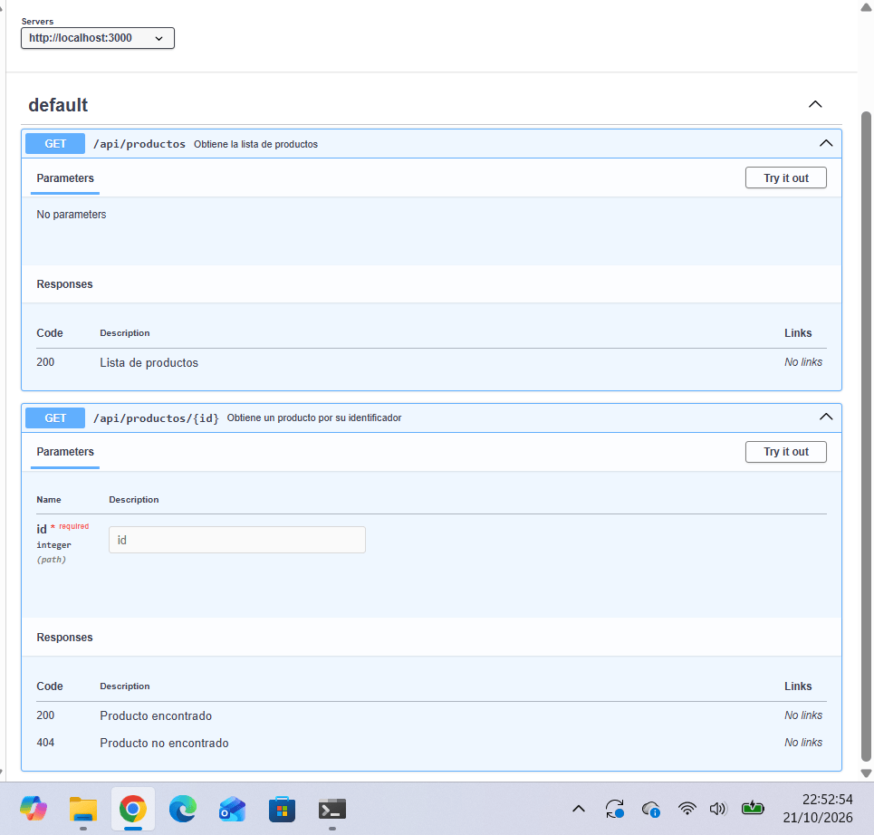

# API

## ¿Qué es OpenAPI?

OpenAPI es un estándar, independiente del lenguaje de programación, para describir una API REST: qué rutas tiene, qué métodos HTTP admite, qué parámetros recibe y qué respuestas puede devolver. La descripción se guarda en un fichero YAML o JSON (en este proyecto, `openapi.yaml`). Este fichero no ejecuta la API, solo la describe.

## ¿Para qué sirve Swagger UI?

Swagger UI convierte la descripción OpenAPI en documentación web visual e interactiva, donde se pueden consultar los endpoints, sus parámetros y respuestas, y probarlos.

## Endpoints

- `GET /api/productos`: devuelve la lista de productos. Respuesta `200`.
- `GET /api/productos/{id}`: devuelve un producto por su identificador (`id` entero en la ruta). Respuestas `200` (producto encontrado) y `404` (producto no encontrado).

## Captura de Swagger UI

