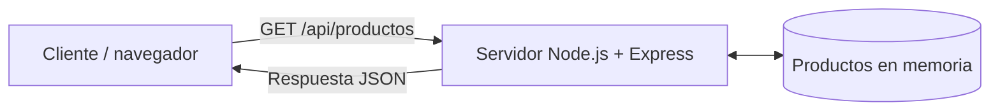

# Arquitectura

El cliente (navegador, curl o Postman) envía una petición HTTP al servidor Node.js + Express, que escucha en el puerto 3000. El servidor consulta los productos, que están guardados en memoria dentro de `app.js`, y devuelve la respuesta en formato JSON.

## Reflexiona

**¿Qué cambiaría en la arquitectura si los productos estuvieran almacenados en una base de datos?**

Habría un componente más: el servidor ya no tendría los datos en memoria, sino que los consultaría a una base de datos externa. Además, habría que instalar y configurar la base de datos, y guardar sus credenciales fuera del repositorio (por ejemplo en un fichero `.env` incluido en `.gitignore`).
